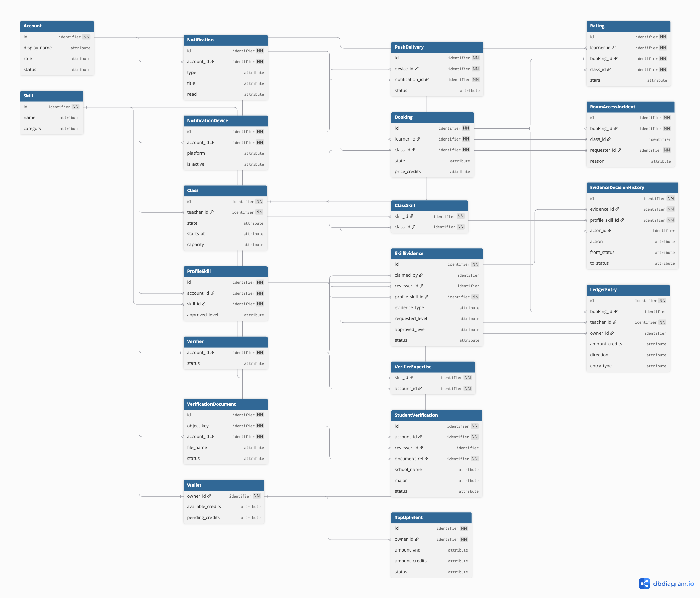
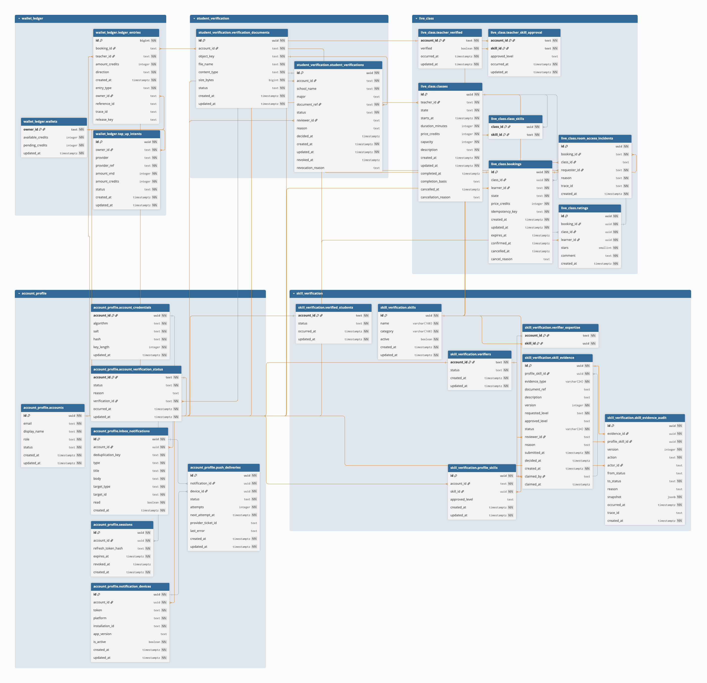
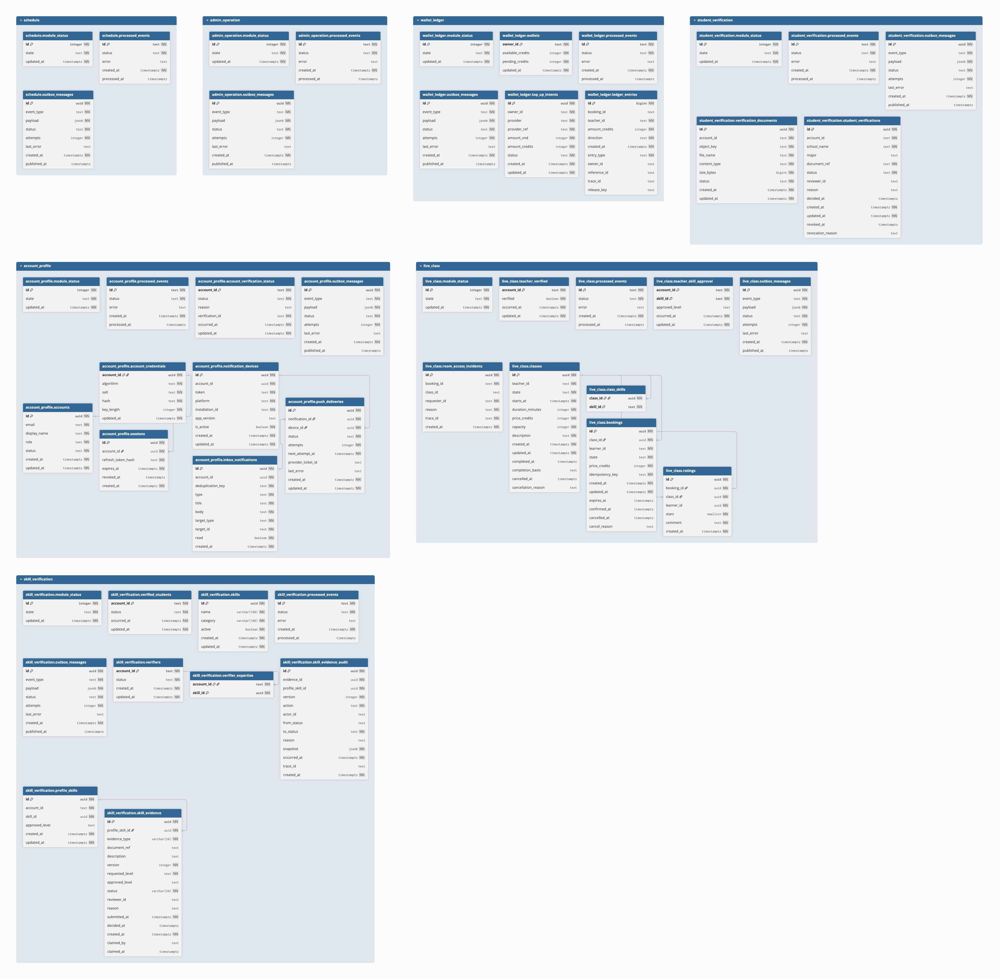

# SkillSwap

SkillSwap là nền tảng mobile-first (web mobile + ứng dụng mobile Expo/React Native) kết nối sinh viên có nhu cầu học kỹ năng với sinh viên đã được xác minh năng lực để giảng dạy trực tuyến.

A peer-to-peer skill marketplace: learners top up real money into credits (1 credit = 1,000 VND) and book classes from verified student teachers; the platform keeps 10%. Integer VND everywhere, Vietnamese/English, mobile-first — responsive web plus native mobile app ([ADR-015](docs/adr/ADR-015-mobile-client-expo.md)).

## Stack

- **pnpm monorepo** — `apps/gateway` (NestJS BFF, :4000) · `apps/api` (NestJS modular monolith, :4001) · `apps/web` (Next.js 15 + next-intl, :3000) · `apps/mobile` (Expo/React Native, [ADR-015](docs/adr/ADR-015-mobile-client-expo.md)) · `packages/contracts` (Zod)
- **PostgreSQL 17** — one database, seven schemas, per-module roles/credentials ([ADR-014](docs/adr/ADR-014-persistence-typeorm.md), TypeORM)
- **RabbitMQ 3.13** — topic exchange `skillswap.events`, transactional outbox + idempotent consumers ([ADR-013](docs/adr/ADR-013-message-broker-rabbitmq.md))

## Quickstart

```bash
pnpm install
pnpm keys:gen          # dev JWT/signing keys
pnpm db:demo           # postgres + rabbitmq, build, migrate, seed demo data
pnpm dev               # gateway :4000, api :4001, web :3000
```

`pnpm db:demo` is the one-command demo bootstrap: it brings the stack up, applies migrations,
and seeds a full dataset (1 admin, 3 verifiers, 10 users, plus skills, verifications, classes,
bookings and wallets). It prints the demo credentials at the end. Re-running it clears and
re-seeds the demo rows, so it is always safe to run again. To step through manually instead:

```bash
pnpm db:up             # postgres + rabbitmq (docker compose)
pnpm db:migrate        # build + apply migrations per module schema
pnpm db:seed-verifier  # (optional) provision one verifier + its expertise
```

Full gate before claiming anything done:

```bash
pnpm verify            # lint && build && typecheck && test && test:arch
```

| Task | Command |
|---|---|
| Lint / build / typecheck / tests / arch rules | `pnpm lint` · `pnpm build` · `pnpm typecheck` · `pnpm test` · `pnpm test:arch` |
| One-command demo (up + migrate + seed) | `pnpm db:demo` |
| Dev stack | `pnpm db:up` / `pnpm db:down` |
| Migrations | `pnpm db:migrate` |
| Seed a verifier | `pnpm db:seed-verifier -- …` |
| Regenerate API reference docs | `pnpm docs:api` |
| Dev keys | `pnpm keys:gen` |
| One app | `pnpm --filter @skillswap/api …` (`api`, `gateway`, `web`, `mobile`, `contracts`) |

Tests: jest (`api`, `gateway`, `contracts`, `mobile`), vitest (`web`). Lint is `--max-warnings=0`. CI runs `pnpm verify` on every push/PR (`.github/workflows/ci.yml`).

## Payment tunnel (ngrok)

SePay (FR-008, [ADR-033](docs/adr/ADR-033-wallet-topup-sepay-payment-gateway.md)) can only
deliver its IPN to a **public HTTPS URL**, so local payment testing needs a tunnel. Every
developer uses the **same reserved domain**, which means the IPN URL is configured in SePay
once and never changes.

### One-time setup

1. **Install ngrok Agent v3** — <https://ngrok.com/download> (`ngrok version` should print `3.x`).
2. **Get an auth token** — <https://dashboard.ngrok.com/get-started/your-authtoken>.
3. **Reserve a domain** — <https://dashboard.ngrok.com/domains>. On the free plan a static
   domain is reserved once and stays the same on every run.
4. **Configure your environment:**
   ```bash
   cp .env.example .env
   ```
   Then set, in `.env`:
   ```dotenv
   NGROK_AUTHTOKEN=<your own ngrok token>
   NGROK_DOMAIN=<team reserved domain, no scheme, e.g. discuss-showbiz-octagon.ngrok-free.dev>
   SEPAY_RETURN_URL=https://<same domain>
   ```
5. **Point `ngrok.yml` at the same domain.** Replace the `url:` under the `api` endpoint with
   `https://<NGROK_DOMAIN>`. The file holds the domain only — **never** a token.
6. **Configure the IPN in SePay:** my.sepay.vn → Payment Gateway → Configuration → IPN →
   `https://<NGROK_DOMAIN>/api/wallet/top-ups/callback`.

### Daily use

```bash
pnpm dev        # gateway :4000, api :4001, web :3000, and the ngrok tunnel in parallel
```

`pnpm dev` starts the tunnel alongside the apps. If ngrok or the token is missing it says so
and continues — only payment testing needs the tunnel. On Windows you can also start (or
re-start) the tunnel on its own:

```powershell
.\scripts\start-ngrok.ps1
```

The script finds the repo root from anywhere, reads `NGROK_AUTHTOKEN` from `.env` without
printing it, checks ngrok is installed, and starts the `api` endpoint from `ngrok.yml`.
Verify it is up at <http://127.0.0.1:4040> (the ngrok inspector).

### Notes

- The stable URL comes from the **ngrok account/domain reservation**, not from the project
  file: `ngrok.yml` only records which domain and which local port to use.
- `agent.authtoken: ${NGROK_AUTHTOKEN}` does **not** work — ngrok passes the literal string
  through instead of expanding it (`ERR_NGROK_105`). The token is therefore passed at start
  time (the launcher uses `--authtoken`, the PowerShell script exports it).
- **Concurrent use of one reserved domain** depends on your ngrok plan. Two developers running
  the same endpoint at once get `ERR_NGROK_334` unless the plan supports endpoint pooling
  (`--pooling-enabled`); otherwise take turns, or reserve a domain per developer.
- The token is a secret: it stays in `.env` (git-ignored). Never commit `.env`, and never add
  an authtoken to `ngrok.yml`.

## Repository layout

```
apps/gateway    NestJS BFF — public REST, auth, route → RPC
apps/api        business logic — 7 hexagonal modules under src/modules/
apps/web        Next.js UI (register: product — see DESIGN.md)
apps/mobile     Expo/React Native client (ADR-015; integrates with Gateway APIs)
packages/contracts  Zod schemas shared by api/gateway
scripts/        migrate.mjs, generate-dev-keys.mjs, generate-api-modules.mjs
docker/         postgres init (7 roles + 7 schemas, ADR-007)
docs/           intent, plans (SRS/PRD/BRD), ADRs, C4 diagrams
```

## Documentation

**For agents/contributors — start with [AGENTS.md](AGENTS.md).**

- [ARCHITECTURE.md](ARCHITECTURE.md) — hard contract: contexts, boundaries, dependency rules (never edit)
- [PRODUCT.md](PRODUCT.md) · [DESIGN.md](DESIGN.md) — users, brand, visual system
- [docs/intent.md](docs/intent.md) — problem, outcome, users
- [docs/plans/SkillSwap-SRS.md](docs/plans/SkillSwap-SRS.md) — requirements with stable IDs (`FR`/`BR`/`NFR`/`OQ`/`AC`/`ST`)
- [docs/adr/](docs/adr/) — ADR-013 (RabbitMQ), ADR-014 (TypeORM), ADR-015 (mobile app + doc sync)
- [Bộ diagram checkpoint hiện tại (Structurizr + PlantUML)](docs/diagrams/checkpoint/README.md)
- [Conceptual, Logical và Physical data model theo migration hiện tại](#mô-hình-dữ-liệu)
- [SkillSwap MVP Software Development Blueprint](docs/plans/2026-09-15-001-feat-skillswap-mvp-requirements-plan.md)
- [GitHub Project: SkillSwap MVP Requirements](https://github.com/users/trankien022/projects/1)

The Blueprint is `Ready for Review`, not `Approved`: open product decisions remain visible as `OQ-###` Spike items and block only the affected requirements. In the personal GitHub Project, `Work Type` is the functional equivalent of the teacher model's reserved `Type` field, and built-in `Assignees` represents `Owner`.

## Mô hình dữ liệu

Các mô hình dưới đây mô tả dữ liệu SkillSwap theo migration trong mã nguồn được đối chiếu ngày **12/10/2026**, phục vụ truy vết **Architecture → Business Flow → API → Source Code → Data**.

Code DBML và ảnh đặt tại `docs/diagrams/data/current/`. Đây là bộ mô hình dùng để giải thích implementation hiện tại. [Tài liệu thiết kế dữ liệu trước đây](docs/diagrams/data/README.md) được giữ làm tài liệu lịch sử; có cấu trúc khác với migration hiện tại.

### Tổng quan

| Mô hình | Phạm vi | Số quan hệ |
|---|---|---:|
| Conceptual ERD | 20 thực thể nghiệp vụ | 35 |
| Logical ERD | 26 bảng nghiệp vụ, xác thực, thông báo và projection | 43 |
| Physical Database ERD | 47 bảng thuộc 7 schema, bao gồm bảng hỗ trợ kỹ thuật | 10 FK |

Conceptual giải thích các đối tượng nghiệp vụ và quan hệ giữa chúng. Logical bổ sung cấu trúc bảng và các liên kết do ứng dụng xử lý. Physical chỉ thể hiện các khóa ngoại thực sự được khai báo trong migration.

### Conceptual ERD



[Mở ảnh đầy đủ](docs/diagrams/data/current/images/skillswap-conceptual-erd.png) · [Code DBML](docs/diagrams/data/current/SkillSwap_Conceptual_Checkpoint.dbml) · [Code TXT](docs/diagrams/data/current/SkillSwap_Conceptual_Checkpoint.txt)

Mô hình bao gồm tài khoản, verifier và chuyên môn, kỹ năng và minh chứng, xác minh sinh viên và tài liệu, lớp học và booking, đánh giá, ví và nạp tiền, thông báo và push delivery.

`identifier` và `attribute` là ký hiệu trung tính để biểu diễn trong dbdiagram, không phải kiểu dữ liệu lưu trữ. Các trường liên kết được giữ vì công cụ cần chúng để vẽ quan hệ. Bản này là cách biểu diễn mô hình nghiệp vụ bằng công cụ ERD; không thể hiện index hay ràng buộc lưu trữ PostgreSQL.

### Logical ERD



[Mở ảnh đầy đủ](docs/diagrams/data/current/images/skillswap-logical-erd.png) · [Code DBML](docs/diagrams/data/current/SkillSwap_Logical_Checkpoint.dbml) · [Code TXT](docs/diagrams/data/current/SkillSwap_Logical_Checkpoint.txt)

Mô hình gồm **26 bảng và 43 quan hệ**. Các bảng được nhóm theo schema/module sở hữu dữ liệu.

| Ký hiệu | Ý nghĩa |
|---|---|
| Đường xám | 10 khóa ngoại được khai báo trong database |
| Đường cam | 33 liên kết logic do ứng dụng xử lý, không phải FK SQL |
| PK / biểu tượng khóa | Khóa chính |
| NN | NOT NULL |
| Unique / index | Tính duy nhất và index được khai báo trong code DBML |

Các định danh liên kết giữa module được trao đổi qua ứng dụng/sự kiện. Vì vậy, một quan hệ nghiệp vụ có thể được thể hiện trong Logical nhưng không có FK tương ứng trong Physical.

**Dùng Logical để giải thích thiết kế.** Không dùng SQL xuất từ mô hình này để áp migration, vì các đường cam có thể được công cụ chuyển thành FK không tồn tại trong kiến trúc hiện tại.

### Physical Database ERD



[Mở ảnh đầy đủ](docs/diagrams/data/current/images/skillswap-physical-database-erd.png) · [Code DBML](docs/diagrams/data/current/SkillSwap_CurrentDatabase.dbml) · [Code TXT](docs/diagrams/data/current/SkillSwap_CurrentDatabase.txt)

Mô hình gồm **47 bảng, 314 cột và 10 FK trong 7 schema**. Mỗi module sở hữu schema riêng; không có FK xuyên schema trong bộ migration được đối chiếu.

| Schema | Trách nhiệm dữ liệu | Số bảng |
|---|---|---:|
| `account_profile` | Tài khoản, thông tin xác thực, phiên đăng nhập, trạng thái xác minh và thông báo | 10 |
| `admin_operation` | Trạng thái module và dữ liệu hỗ trợ sự kiện | 3 |
| `live_class` | Lớp học, booking, đánh giá, room incident và projection độ tin cậy của giáo viên | 10 |
| `schedule` | Trạng thái module và dữ liệu hỗ trợ sự kiện | 3 |
| `skill_verification` | Danh mục kỹ năng, hồ sơ kỹ năng, minh chứng, verifier và lịch sử quyết định | 10 |
| `student_verification` | Yêu cầu xác minh sinh viên và metadata tài liệu | 5 |
| `wallet_ledger` | Ví, yêu cầu nạp tiền và các bút toán | 6 |
| **Tổng** | | **47** |

Trong mỗi schema, `module_status`, `outbox_messages` và `processed_events` hỗ trợ quản lý trạng thái module, transactional outbox và xử lý sự kiện theo cơ chế idempotency. Tổng cộng có 21 bảng hỗ trợ này.

CHECK constraint và partial index được giữ trong **Note** dưới dạng định nghĩa SQL. Chúng không được DBML thực thi từ Note; đặc biệt, partial unique không được thay bằng unique trên toàn bảng. Migration trong mã nguồn là nguồn để áp các ràng buộc lên database.

### Quyết định dữ liệu trong implementation hiện tại

- `accounts` lưu một role: `user`, `verifier` hoặc `admin`. Học và dạy là khả năng của tài khoản, không phải hai bảng tài khoản riêng.
- `profile_skills` gắn trực tiếp với `account_id`. Hồ sơ công khai được tổng hợp từ dữ liệu tài khoản và xác minh, không có bảng `profiles` trong migration hiện tại.
- `student_verifications` lưu `school_name` và `major` dạng text. `document_ref` lưu object key của tài liệu đã upload; ứng dụng liên kết với `verification_documents.object_key`.
- `verifiers` có lifecycle riêng. `verifier_expertise` xác định kỹ năng được phép review; `claimed_by`, `claimed_at` và `skill_evidence_audit` giữ trạng thái claim và lịch sử quyết định.
- `classes` và `bookings` dùng trường `state`. Mỗi Class là một buổi học được lên lịch; `class_skills` liên kết lớp với kỹ năng.
- Ví hiện dùng `wallets`, `top_up_intents` và `ledger_entries`; credit được lưu bằng số nguyên.
- Push notification có `notification_devices`, `inbox_notifications` và `push_deliveries`.
- Các tham chiếu đa hình như `target_id` trong thông báo và `reference_id` trong ledger không bị ép thành FK đến một bảng cố định.

### Sử dụng code trên dbdiagram.io

1. Tạo một diagram riêng cho từng mô hình.
2. Mở file `.txt` hoặc `.dbml` tương ứng ở chế độ văn bản và sao chép toàn bộ nội dung.
3. Dán vào editor của [dbdiagram.io](https://dbdiagram.io).
4. Giữ nguyên các dấu `[ ]`, khối `indexes`, khai báo `Ref` và `TableGroup`.
5. Khi xuất Logical, giữ chú thích đường xám/cam trong tài liệu đi kèm.

Mỗi file code là một mô hình đầy đủ; không ghép ba file vào cùng một diagram.

### Kiểm tra và truy vết

Chuỗi migration đăng ký trong repository đã được chạy trên một engine PostgreSQL-compatible PGlite độc lập, rồi đọc catalog sau khi migration hoàn tất.

- Tái dựng được 47 bảng và 314 cột trong 7 schema.
- Tên cột và NULL/NOT NULL của bản Physical được đối chiếu với catalog tái dựng.
- Cả ba file DBML phân tích cú pháp thành công bằng `@dbml/core` ở chế độ `dbmlv2`.
- Số bảng và quan hệ của từng mô hình khớp với phạm vi ghi ở đầu tài liệu.
- Ba ảnh xuất từ dbdiagram được đối chiếu về cấu trúc tổng quan và quy ước hiển thị quan hệ.

Bằng chứng: [Kết quả kiểm tra](docs/diagrams/data/current/validation.json) · [Danh sách migration nguồn](docs/diagrams/data/current/migration-source-map.json).

Nguồn cấu trúc là các migration tại `apps/api/src/modules/<module>/internal/adapter/out/persistence/migrations/`. Đăng ký migration nằm trong `data-source.ts` của từng module. Liên kết object key của tài liệu được đối chiếu với `submit-student-verification.use-case.ts`.

Kết quả phản ánh migration trong checkout được kiểm tra, chưa xác nhận database môi trường demo/production đã áp đầy đủ migration. Các đường cam là diễn giải liên kết từ identifier và mã ứng dụng, không phải ràng buộc database.

### Phạm vi đối với SWD392 Checkpoint

ERD hỗ trợ phần **Data** trong truy vết **Architecture → Business Flow → API → Source Code → Data**. Tài liệu checkpoint yêu cầu sơ đồ phản ánh implementation, nhưng không quy định riêng phải nộp Conceptual và Logical ERD.

Bộ mô hình này cần được sử dụng cùng C4 C0/C1, Use Case/User Stories, Sequence, Activity, State Diagram và phần demo luồng nghiệp vụ. Ảnh sơ đồ không thay thế bằng chứng hệ thống chạy end-to-end.
