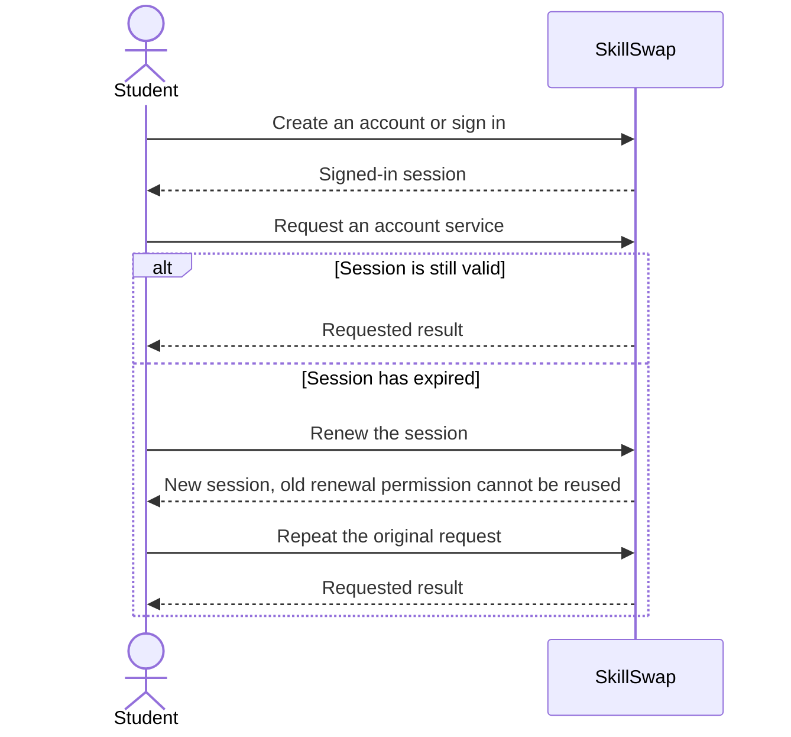
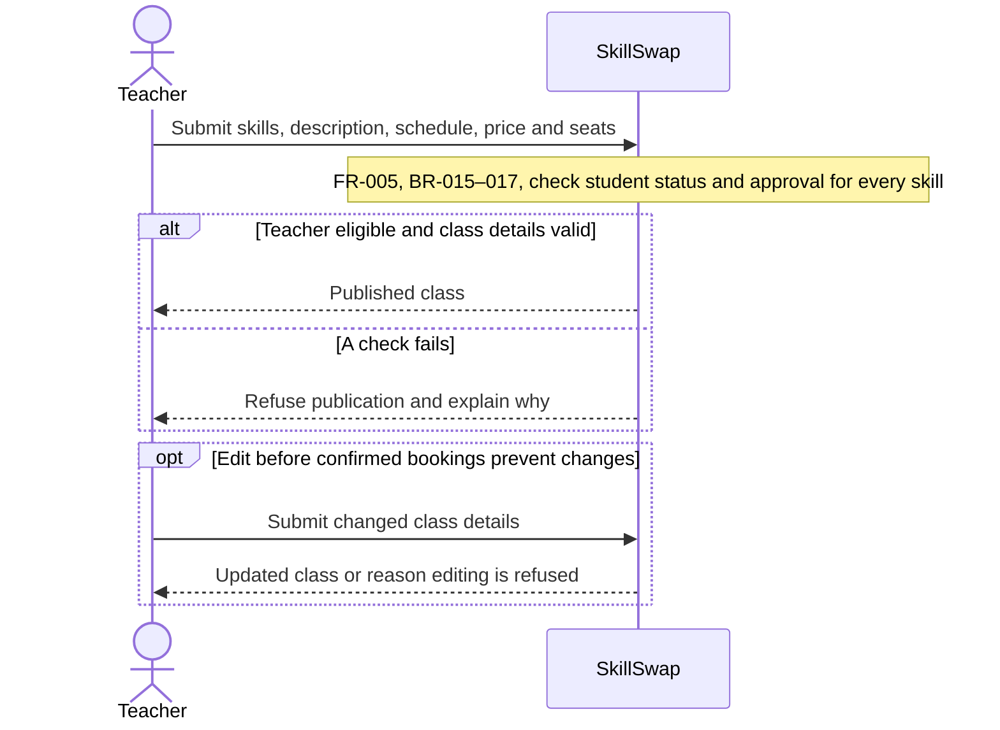
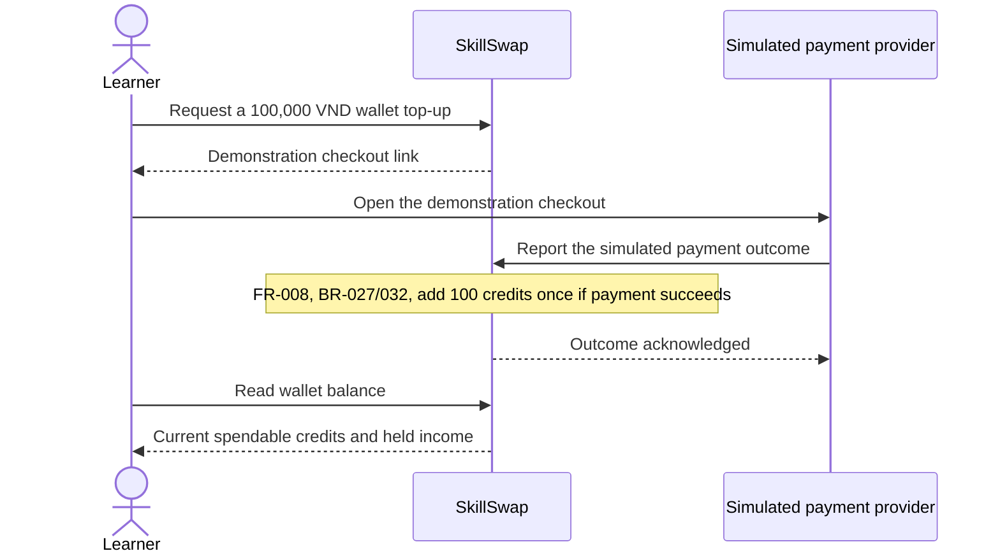
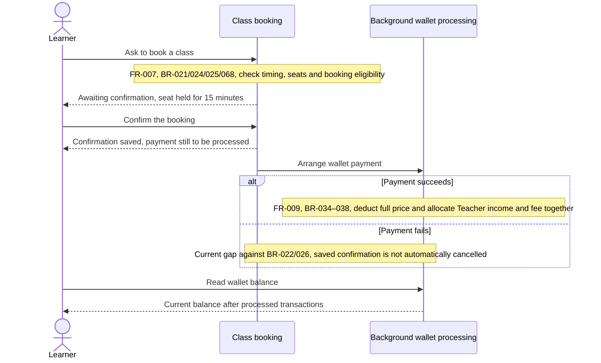
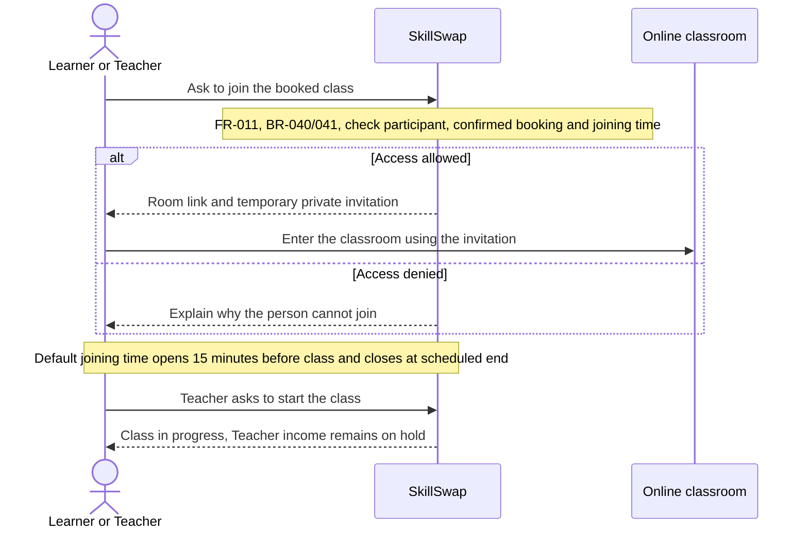
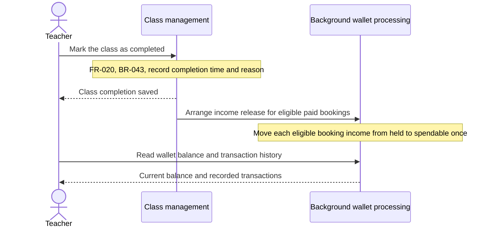
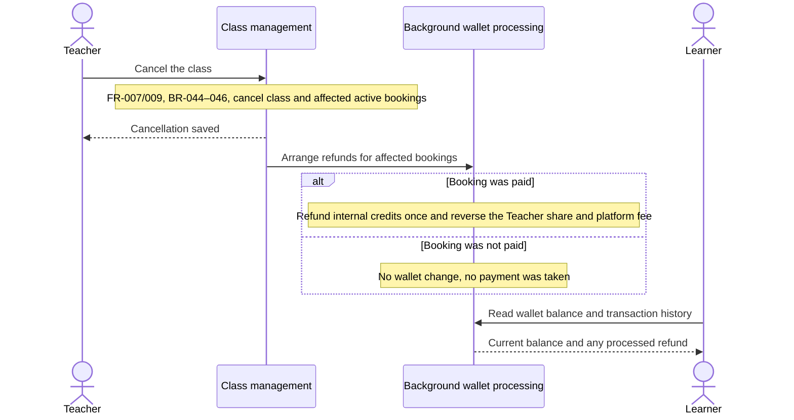

# SkillSwap API — Frontend Integration Guide

How the frontend talks to the backend for the **booking / paid-class / join-class** flow,
written from the perspective of "what do I call, at which step, with what body, and what
comes back".

> Status: covers the implemented critical path — **auth (FR-001), wallet top-up (FR-008),
> settlement (FR-009), booking lifecycle + refunds (FR-007), room access (FR-011), class
> completion + income release (FR-020), wallet reads (FR-010)**.
> Rating (FR-013), withdrawals (FR-014) and chat (FR-012) are **not** implemented yet.
> Student/skill verification and publication checks are supported by the backend; client integration remains incomplete.

---

## 1. Base URL, ports, and how a request flows

| Layer | Dev URL | Notes |
|---|---|---|
| **Gateway** (public entry) | `http://localhost:4000` | what the frontend calls |
| API (internal) | `http://localhost:4001` | not called directly by the FE |
| Web app | `http://localhost:3000` | |
| Jitsi (room host) | `https://localhost:8443` | dev self-signed TLS |

All routes are prefixed with **`/api`**. The gateway forwards `/api/*` to the API and, when
auth is on, verifies the bearer token and injects trusted `x-user-*` headers.

```
Browser ──▶ gateway :4000/api/* ──(verify JWT, inject identity)──▶ api :4001/api/*
```

**Base URL for the FE:** `const API = process.env.NEXT_PUBLIC_API_BASE_URL ?? 'http://localhost:4000'`.
Every path below is relative to `API` and already includes `/api`.

### Auth header
After login/register you hold an `accessToken`. Attach it to **every** authenticated request:

```
Authorization: Bearer <accessToken>
```

### Response envelope

Every domain response uses the uniform envelope (see `docs/api/RESPONSE-CONVENTIONS.md`,
**NFR-013**). Health probes (`GET /health`) are the only exemption.

Success:
```json
{
  "success": true,
  "code": "ME_OK",
  "message": "Account loaded",
  "data": { "id": "…" },
  "errors": []
}
```

Error:
```json
{
  "success": false,
  "code": "RoomAccessDeniedError",
  "message": "Room access opens shortly before the class starts",
  "data": null,
  "errors": [
    { "code": "RoomAccessDeniedError", "message": "Room access opens shortly before the class starts" }
  ]
}
```

Read the payload from `body.data`; branch on `body.success` and `body.code` / `body.errors[].code`
(never on `message`). The HTTP status code still reflects the real outcome.

Common status codes: `400` invalid body/query, `401` missing/expired token or bad credentials,
`403` forbidden (not a party / suspended / not owner), `404` not found, `409` conflict
(duplicate email, class locked, illegal transition), `503` room provider unavailable.

---

## 2. Endpoint reference

### 2.1 Auth — FR-001 (`/api/auth`)

| Method | Path | Auth | Body | Returns |
|---|---|---|---|---|
| POST | `/api/auth/register` | none | `{ email, displayName, password, role? }` | `201` token pair |
| POST | `/api/auth/login` | none | `{ email, password }` | `200` token pair |
| POST | `/api/auth/refresh` | none | `{ refreshToken }` | `200` token pair (rotates) |
| POST | `/api/auth/logout` | none | `{ refreshToken }` | `204` |
| GET | `/api/auth/me` | **yes** | — | `200` account |

`role` ∈ `user` only (default `user`); `verifier`/`admin` are provisioned out of band (ADR-030). `password` ≥ 8 chars. Account roles are `user | verifier | admin`; Learner/Teacher are capabilities, not roles.

**Token pair** (`tokenResponseSchema`):
```json
{ "accessToken": "eyJ…", "refreshToken": "…", "expiresIn": 900, "tokenType": "Bearer" }
```

**`me`** (`meResponseSchema`):
```json
{ "id": "uuid", "email": "a@b.co", "displayName": "An", "role": "user", "status": "active" }
```

Register example:
```js
const res = await fetch(`${API}/api/auth/register`, {
  method: 'POST',
  headers: { 'content-type': 'application/json' },
  // role is optional; only 'user' is accepted (ADR-030). Verifier/admin are provisioned out of band.
  body: JSON.stringify({ email: 'an@b.co', displayName: 'An', password: 'secret-password' }),
});
const { accessToken, refreshToken } = await res.json(); // store these
```

> The `accessToken` is short-lived (`expiresIn` seconds, 900 by default). On `401`, call
> `/api/auth/refresh` with the `refreshToken` to get a new pair, then retry. Refresh is
> **single-use**: the old `refreshToken` is invalidated and a new one is returned — replace
> your stored one.

---

### 2.2 Wallet — FR-008 / FR-010 (`/api/wallet`)

| Method | Path | Auth | Body/Query | Returns |
|---|---|---|---|---|
| POST | `/api/wallet/top-ups` | **yes** | `{ amountVnd }` | `201` top-up intent |
| POST | `/api/wallet/top-ups/callback` | **no** (HMAC) | `{ providerRef, amountVnd, status }` + `x-signature` | `200` `{ applied, status }` |
| GET | `/api/wallet/balance` | **yes** | — | `200` `{ availableCredits, pendingCredits }` |
| GET | `/api/wallet/history` | **yes** | `?limit=&cursor=` | `200` paged envelope (`{ items, page }`) |

- `amountVnd` is an **integer VND**, max `100,000,000`, and must be a whole number of
  credits at **1 credit = 1,000 VND** (so `100000` → 100 credits).
- **Top-up intent** (`topUpIntentSchema`):
  ```json
  { "id": "…", "ownerId": "…", "provider": "mock", "providerRef": "…",
    "amountVnd": 100000, "amountCredits": 100, "status": "pending",
    "paymentUrl": "https://mock.pay.skillswap.local/checkout?ref=…&amount=100000" }
  ```
  Send the user to `paymentUrl`. The **callback is called by the payment provider**, not the
  browser (in dev it is the mock gateway). The FE just polls the balance until it updates.
- **Balance:** `availableCredits` = spendable, `pendingCredits` = the Teacher's held income
  (0 for a Learner).
- **History item** (`walletHistoryItemSchema`):
  ```json
  { "id": "1", "type": "top_up", "direction": "credit", "amountCredits": 100,
    "status": "completed", "reference": null, "createdAt": "2026-10-12T10:00:00.000Z" }
  ```
  `direction` ∈ `credit|debit`; `status` ∈ `completed|reversed`. Page size 1–100
  (default 20); pass `cursor` from the previous page's `nextCursor` to get the next page
  (`nextCursor: null` = end).

Top-up + poll example:
```js
await fetch(`${API}/api/wallet/top-ups`, { method: 'POST', headers: authJson, body: JSON.stringify({ amountVnd: 100000 }) });
// redirect user to the returned paymentUrl; then poll:
const bal = await (await fetch(`${API}/api/wallet/balance`, { headers: auth })).json();
// bal.availableCredits === 100 when settled
```

---

### 2.3 Classes & bookings — FR-005 / FR-007 / FR-009 / FR-020 (`/api/classes`)

| Method | Path | Who | Body | Returns |
|---|---|---|---|---|
| POST | `/api/classes` | **Teacher** | `createClassSchema` | `201` class |
| PATCH | `/api/classes/:id` | **Teacher** (owner) | `updateClassSchema` | `200` class |
| POST | `/api/classes/:id/cancel` | **Teacher** (owner) | — | `200` `{ classCancelled, bookingsCancelled }` |
| POST | `/api/classes/:id/start` | **Teacher** (owner) | — | `200` `{ started }` |
| POST | `/api/classes/:id/complete` | **Teacher** (owner) | — | `200` `{ completed, basis }` |
| POST | `/api/classes/:id/bookings` | **Learner** | `{ idempotencyKey }` | `201` `{ booking, created }` |
| POST | `/api/classes/bookings/:bookingId/confirm` | **Learner** (owner) | — | `200` confirm result |
| POST | `/api/classes/bookings/:bookingId/room-access` | **party** | `{ displayName? }` | `200` room access |
| POST | `/api/classes/bookings/:bookingId/no-show` | system/Teacher | — | `200` `{ cancelled }` |

**Create class** (`createClassSchema`):
```json
{ "skillIds": ["skill-guitar"], "description": "Intro to guitar",
  "startsAt": "2026-10-14T10:00:00.000Z", "durationMinutes": 60,
  "priceCredits": 100, "capacity": 2 }
```
Rules: `startsAt` must be **in the future** and bookings require **≥ 24 h lead time**;
`durationMinutes` 30–180; `priceCredits` > 0; `capacity` ≥ 1.

**Class** (`classSchema`):
```json
{ "id": "cls…", "teacherId": "…", "state": "published",
  "startsAt": "…", "durationMinutes": 60, "priceCredits": 100, "capacity": 2 }
```
`state` ∈ `draft | published | full | in_progress | completed | cancelled`.

**Edit class** (`updateClassSchema`, all fields optional, at least one): any of
`skillIds, description, startsAt, durationMinutes, priceCredits, capacity`.
Once **any booking is confirmed** the class is **locked** → `409 ClassLockedError`.

**Book** (`bookingRequestSchema`): `{ "idempotencyKey": "a-uuid-you-generate" }`. Reusing the
key returns the same booking (`created: false`). Returns `bookingSchema`:
```json
{ "booking": { "bookingId": "…", "classId": "…", "learnerId": "…",
  "state": "pending", "priceCredits": 100, "createdAt": "…" }, "created": true }
```
A new booking is **`pending`** and holds a seat for **~15 minutes**; if not confirmed in
time it auto-cancels and frees the seat.

**Confirm** (`{ bookingId, learnerId }` internally): flips `pending → confirmed` and settles
payment **asynchronously** — the Learner is debited `priceCredits`, the Teacher is credited
90% as *pending* income, 10% is the platform fee. Response:
```json
{ "confirmed": true, "booking": { "…": "…", "state": "confirmed" } }
```
Current gap against BR-022/BR-026: confirmation is saved before payment processing.
Insufficient balance does not automatically restore the booking to `pending`.
The FE should re-read `/api/wallet/balance` after a moment to reflect the debit.

**Room access** (`roomAccessResponseSchema`):
```json
{ "room": "skillswap-<classId>", "token": "eyJ…", "expiresAt": "…",
  "url": "https://localhost:8443/skillswap-<classId>" }
```
Only for a **party to a confirmed booking**, and only inside the window: **opens 15 min
before `startsAt`**, closes at `startsAt + durationMinutes`. Outside → `403`. Load Jitsi with
the returned `url`, room `room`, and JWT `token` (the teacher's token is a moderator token).

**Class lifecycle**: `start` runs the session (`published|full → in_progress`); `complete`
ends it (`→ completed`) and **releases the Teacher's pending income** to available. A class
whose Teacher no-showed is **cancelled** by the system instead (see below).

---

## 3. Sequence diagrams, split by task

Each diagram covers one task; read **3.1–3.6** for the happy path and **3.7** for
cancellation/refunds. Auth is shared by both roles; publishing and top-up can happen
independently before booking.

Diagram labels use plain English actions and outcomes, with FR/BR references.
They describe backend capabilities; the current web/mobile booking screens are local demonstrations.
Background wallet processing runs after the class operation. Endpoint details remain in §2.
Wallet reads in these diagrams go through SkillSwap, not directly to an internal wallet service.

| Part | Task | Requirement |
|---|---|---|
| [3.1](#31-authenticate-and-refresh-the-session) | Authenticate and refresh | FR-001 |
| [3.2](#32-teacher-publishes-a-class) | Publish a class | FR-005 |
| [3.3](#33-learner-tops-up-the-wallet) | Top up and read balance | FR-008 / FR-010 |
| [3.4](#34-learner-books-and-confirms) | Hold a seat, confirm and settle | FR-007 / FR-009 |
| [3.5](#35-participants-join-and-teacher-starts-the-class) | Get room access, join and start | FR-011 / FR-020 |
| [3.6](#36-class-completes-and-teacher-income-is-released) | Complete and release income | FR-020 / FR-010 |
| [3.7](#37-cancellation-and-refund) | Cancel and refund | FR-007 / FR-009 |

### 3.1 Authenticate and refresh the session



If refresh fails, clear the stored tokens and require sign-in again (§5).

### 3.2 Teacher publishes a class



After the first confirmed booking, editing returns `409 ClassLockedError`.

### 3.3 Learner tops up the wallet



The **provider sends the callback**; the browser only opens checkout and reads balance.
Here `100000` integer VND adds `100` credits; a repeated callback cannot add them twice.

### 3.4 Learner books and confirms



Reuse the **same** `idempotencyKey` when retrying booking creation (`created: false`).
The confirm HTTP response and wallet settlement are separate: the balance can lag,
so do not treat `200` as proof that the wallet debit has finished. See §4 for insufficient
credit and hold expiry.

### 3.5 Participants join and Teacher starts the class



Room access is requested separately by each participant. Denied access returns `403`;
provider failure returns `503`. The system can also start the class at its scheduled time.

### 3.6 Class completes and Teacher income is released



This shows the explicit Teacher completion path. The system can also complete at scheduled
end with basis `scheduled_end` (ADR-021). A Teacher no-show leads to cancellation instead;
income is not released. Release moves existing pending income into available credit.

### 3.7 Cancellation and refund



Refunds are **internal credits**, never a payment-provider payout. Teacher no-show and
pending-hold expiry also emit `booking.cancelled`; only previously settled bookings are
refunded (ADR-019). There is no Learner self-cancellation endpoint in this MVP.

### 3.8 Happy-path checklist and Learner call order

1. **Teacher** registers (`role: user`), publishes a class (`POST /api/classes`).
2. **Learner** registers (`role: user`).
3. **Learner** funds the wallet: `POST /api/wallet/top-ups` → pay → `GET /api/wallet/balance`.
4. **Learner** books: `POST /api/classes/:id/bookings` with an idempotency key → `pending`.
5. **Learner** confirms: `POST /api/classes/bookings/:bookingId/confirm` → settles.
6. Near start time, **Learner** (and **Teacher**) fetch room access and join Jitsi.
7. **Teacher** completes: `POST /api/classes/:id/complete` → income released.
8. Anyone reads their ledger: `GET /api/wallet/history`.

API calls in order (Learner side):
```js
// 3. top up
await post('/api/wallet/top-ups', { amountVnd: 100000 });      // → redirect to paymentUrl
// 4. book
const { booking } = await post(`/api/classes/${classId}/bookings`, { idempotencyKey: crypto.randomUUID() });
// 5. confirm (pay)
await post(`/api/classes/bookings/${booking.bookingId}/confirm`);
// 6. join (only inside the window)
const access = await post(`/api/classes/bookings/${booking.bookingId}/room-access`, { displayName: 'An' });
// access.url + access.token → Jitsi
```

---

## 4. Failure & edge cases the FE must handle

| Situation | Where | Response |
|---|---|---|
| Booking < 24 h before start | `POST …/bookings` | `409` `BookingNotAllowedError` (`booking_window_closed`) |
| Class full / duplicate / self-booking | `POST …/bookings` | `409` `BookingNotAllowedError` (`class_full` / `duplicate_booking` / `self_booking`) |
| Not enough credits at confirm | `POST …/confirm` | `200` then booking stays `pending` (no balance change) |
| Pending hold not confirmed in ~15 min | system | booking auto-`cancelled` (reason `expired`), seat freed |
| Teacher cancels class | `POST /classes/:id/cancel` | active bookings cancelled; **confirmed ones refunded** to the Learner |
| Teacher no-shows (no join within 15 min of start) | system/`…/no-show` | booking cancelled, Learner refunded, Teacher earns nothing |
| Edit a class after a confirmed booking | `PATCH /classes/:id` | `409` `ClassLockedError` |
| Room access outside the window / not a party | `POST …/room-access` | `403` `RoomAccessDeniedError` |
| Room provider down | `POST …/room-access` | `503` `RoomUnavailableError` (with a trace id) |
| Duplicate top-up callback | `POST /wallet/top-ups/callback` | `200` `{ applied: false }` (idempotent) |

Refunds are **internal credits only** (no real money). A Learner sees the refund as a
`credit` ledger entry (`type: refund` or the reversal), and `status` is never shown as
`completed` for a non-final entry.

---

## 5. Suggested FE client (TypeScript sketch)

```ts
const API = process.env.NEXT_PUBLIC_API_BASE_URL ?? 'http://localhost:4000';

let accessToken: string | null = null;
let refreshToken: string | null = null;

async function call(path: string, init: RequestInit = {}, retry = true): Promise<Response> {
  const res = await fetch(`${API}/api${path}`, {
    ...init,
    headers: {
      'content-type': 'application/json',
      ...(accessToken ? { authorization: `Bearer ${accessToken}` } : {}),
      ...(init.headers ?? {}),
    },
  });
  if (res.status === 401 && retry && refreshToken) {
    await refreshSession();            // POST /auth/refresh, store the new pair
    return call(path, init, false);
  }
  return res;
}

async function refreshSession() {
  const res = await fetch(`${API}/api/auth/refresh`, {
    method: 'POST', headers: { 'content-type': 'application/json' },
    body: JSON.stringify({ refreshToken }),
  });
  if (!res.ok) { accessToken = refreshToken = null; throw new Error('session expired'); }
  ({ accessToken, refreshToken } = await res.json());
}
```

Key reminders for the UI:
- Store `accessToken`/`refreshToken`; refresh on `401` and **replace** the refresh token.
- Money is **integer credits** everywhere (display `credits`; `1 credit = 1,000 VND`).
- Confirm/complete/refund/release are **event-driven** — UI state may lag a moment; re-read
  `/api/wallet/balance` or the booking state shortly after.
- **Never** send `x-user-*` headers yourself; the gateway injects identity from the JWT.

---

## 6. Where this is defined in code

| Concern | File |
|---|---|
| Request/response schemas (source of truth) | `packages/contracts/src/index.ts` |
| Auth endpoints | `apps/api/src/modules/account-profile/internal/adapter/in/web/auth.controller.ts` |
| Wallet endpoints | `apps/api/src/modules/wallet-ledger/internal/adapter/in/web/wallet.controller.ts` |
| Class/booking endpoints | `apps/api/src/modules/live-class/internal/adapter/in/web/classes.controller.ts` |
| Status → error mapping | `apps/api/src/shared/http/domain-error.filter.ts` |
| Decisions (ADR-016…022) | `docs/adr/` |
| End-to-end usage proof | `apps/api/test/booking-flow.e2e-spec.ts` |
